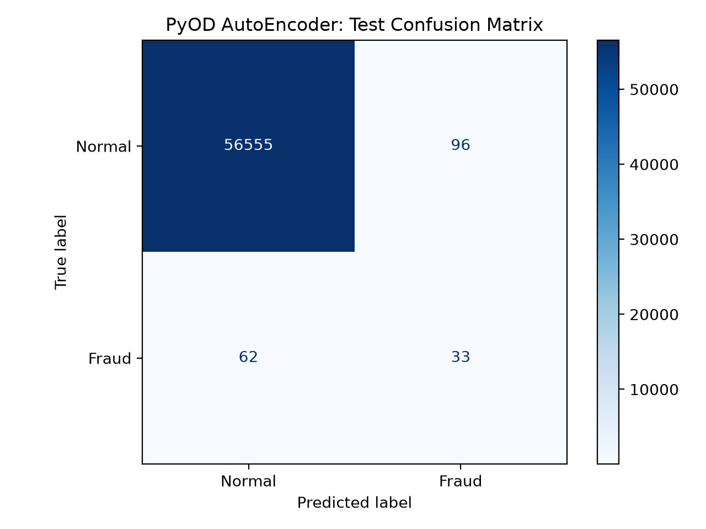

# Credit Card Fraud Detection Using a PyOD AutoEncoder

This project trains a small neural network to identify potentially fraudulent credit card transactions using reconstruction-based anomaly detection. It uses the AutoEncoder implementation in [PyOD](https://github.com/yzhao062/pyod), backed by PyTorch.

The model learns to reconstruct normal transactions. Transactions with larger reconstruction errors receive higher anomaly scores. A threshold selected using validation data converts these scores into normal or potentially fraudulent predictions.

This project was developed for **MCSC-633-M20 Advance Artificial Intelligence** at the **University of the Cumberlands**.

**Author:** Manh Cuong Do  
**Instructor:** Dr. Ulrich Vouama  
**Repository:** [AIA / fraud-detection](https://github.com/cdo-mdo/AIA/tree/main/fraud-detection)

## Project structure

```text
fraud-detection/
├── data/
│   └── creditcard.csv          # Download separately
├── results/
│   ├── confusion_matrix.png    # Generated by the script
│   └── metrics.txt             # Generated by the script
├── fraud_detection.py
├── requirements.txt
└── README.md
```

## Dataset

Download the [Fraud Detection dataset on Kaggle](https://www.kaggle.com/datasets/whenamancodes/fraud-detection), extract it, and place `creditcard.csv` in the `data/` directory. The dataset must be downloaded separately before running the experiment.

The inspected file contains **284,807 transactions** and **31 columns**:

| Columns | Description |
| --- | --- |
| `Time` | Seconds elapsed since the first transaction in the dataset |
| `V1`–`V28` | Numerical features transformed using principal component analysis (PCA) to protect confidential information |
| `Amount` | Transaction amount |
| `Class` | Known label: `0` = normal, `1` = fraud |

The original file contains 284,315 normal transactions and 492 fraudulent transactions. Fraud represents approximately **0.173%** of the records. Original feature definitions and collection details are available in the [ULB dataset description](https://www.kaggle.com/datasets/mlg-ulb/creditcardfraud).

`Class` is excluded from model inputs. Labels identify normal training examples, select the validation threshold, and evaluate predictions.

## Setup and execution

Install Python with `pip` available. The dependency manifest lists PyOD, PyTorch, pandas, NumPy, scikit-learn, and Matplotlib.

### Git Bash on Windows

Clone the repository if you do not already have it:

```bash
git clone https://github.com/cdo-mdo/AIA.git
cd AIA/fraud-detection
```

For an existing checkout at the author's local path:

```bash
cd /e/git/AIA/fraud-detection
```

From the project directory, create and activate a virtual environment:

```bash
python -m venv .venv
source .venv/Scripts/activate
python -m pip install --upgrade pip
python -m pip install -r requirements.txt
mkdir -p data
```

Place the downloaded CSV at `data/creditcard.csv`, then run:

```bash
python fraud_detection.py
```

On macOS or Linux, use `python3` to create the environment and activate it with `source .venv/bin/activate`.

The script uses the CPU, prints training progress and evaluation metrics, and creates the `results/` directory if necessary. Each run replaces the existing metrics and confusion matrix. The recorded local run completed 20 epochs in approximately one minute; runtime varies with hardware and software.

## Experiment workflow

1. Load the CSV and validate the target labels and missing values.
2. Remove exact duplicate rows, leaving **283,726 transactions** in the recorded experiment.
3. Create stratified training, validation, and test partitions with approximately **60% / 20% / 20%** of the data and `random_state=42`.
4. Select only normal transactions from the training partition: **169,951 examples**.
5. Fit `StandardScaler` on these normal training examples and apply the fitted transformation to validation and test features.
6. Train the AutoEncoder on scaled normal training data.
7. Select an anomaly threshold that maximizes validation F1-score using **56,745 validation transactions**.
8. Evaluate the selected threshold on **56,746 held-out test transactions** and save the results.

Because labels are used to select normal training records and tune the threshold, the overall workflow is **semi-supervised anomaly detection**. The reconstruction objective itself does not predict the class label.

## Model configuration

| Parameter | Value |
| --- | --- |
| Input features | 30 |
| Hidden neuron list | `[16, 8]` |
| Epochs | 20 |
| Batch size | 256 |
| Learning rate | 0.001 |
| Dropout rate | 0.1 |
| PyOD preprocessing | Disabled because scaling is applied separately |
| Contamination | 0.01 |
| Random state | 42 |
| Device | CPU |

Final predictions use the **validation-selected cutoff**, rather than PyOD's internal contamination-based threshold. Setting `contamination=0.01` does not mean the dataset contains 1% fraud. The anomaly score is not a fraud probability.

## Recorded results

The completed local experiment selected a threshold of **19.625404**.

| Test metric | Result |
| --- | ---: |
| Fraud precision | 0.2558 |
| Fraud recall | 0.3474 |
| Fraud F1-score | 0.2946 |
| ROC-AUC | 0.9384 |
| Average precision | 0.2042 |
| Overall accuracy | 0.9972 |

| Actual class | Predicted normal | Flagged as fraud |
| --- | ---: | ---: |
| Normal | 56,555 | 96 |
| Fraud | 62 | 33 |



The model detected **33 of 95 fraudulent transactions** and missed 62. Of the 129 flagged transactions, 33 were fraud and 96 were normal. Fraud precision was approximately **25.58%**, and recall was approximately **34.74%**.

Overall accuracy is misleading for this highly imbalanced dataset. Predicting every test transaction as normal would achieve approximately **99.83% accuracy** while detecting no fraud. Precision, recall, and average precision provide additional information about fraud detection performance.

The ROC-AUC summarizes score ranking across thresholds; it does not establish high precision at the selected cutoff. Average precision is reported using `average_precision_score`, rather than a trapezoidal PR-AUC calculation.

## Output files

- [`results/metrics.txt`](results/metrics.txt): Data counts, threshold, ROC-AUC, average precision, and classification report.
- [`results/confusion_matrix.png`](results/confusion_matrix.png): Confusion matrix for test predictions.

The current script reports evaluation results; it does not save a trained model or scaler for later inference.

## Reproducibility and limitations

- The code fixes the split and model random seed at 42. Results may still vary across package versions, hardware, and numerical implementations.
- `requirements.txt` lists unpinned dependencies. To capture exact versions from a working project environment, run `python -m pip freeze > requirements.txt` inside that environment.
- Only one model configuration is reported. Additional epochs or different architectures are possible experiments, not guaranteed improvements.
- The dataset spans a short historical period, and random splitting does not simulate predicting future transactions. A chronological evaluation would provide a different assessment.
- An anomaly is not necessarily fraud. The false alarms and missed frauds in this experiment limit operational usefulness.
- Future model and threshold choices should use validation data. Repeatedly using test results for model selection biases the final estimate.

## References

- [PyOD AutoEncoder documentation and implementation](https://pyod.readthedocs.io/en/latest/_modules/pyod/models/auto_encoder.html)
- [Assignment dataset on Kaggle](https://www.kaggle.com/datasets/whenamancodes/fraud-detection)
- [Original ULB dataset description](https://www.kaggle.com/datasets/mlg-ulb/creditcardfraud)
- Zhao, Y., Nasrullah, Z., & Li, Z. (2019). [PyOD: A Python toolbox for scalable outlier detection](https://jmlr.org/papers/v20/19-011.html). *Journal of Machine Learning Research, 20*(96), 1–7.
